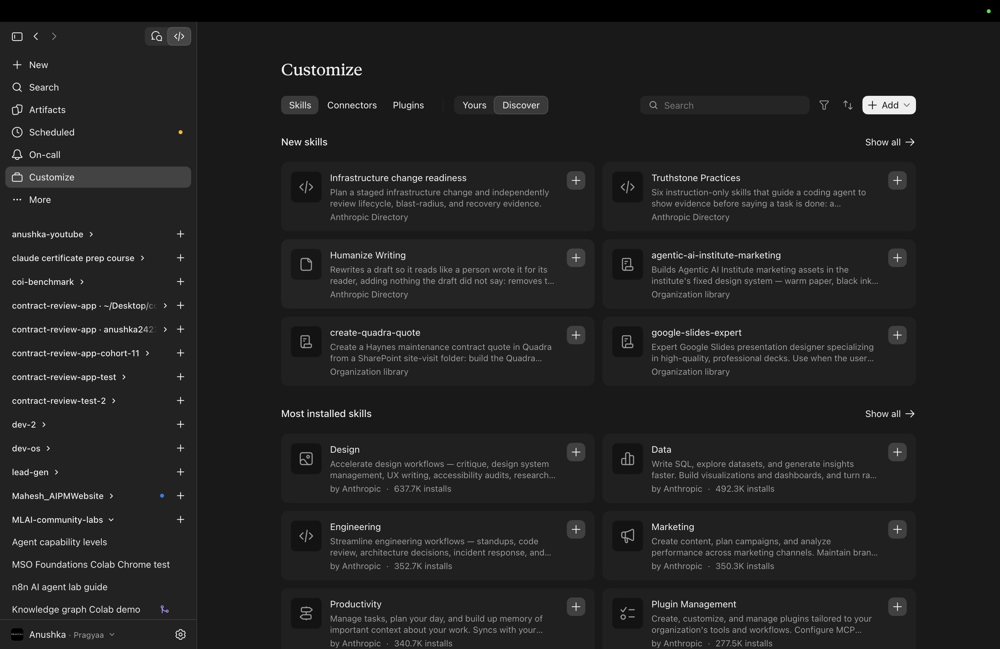
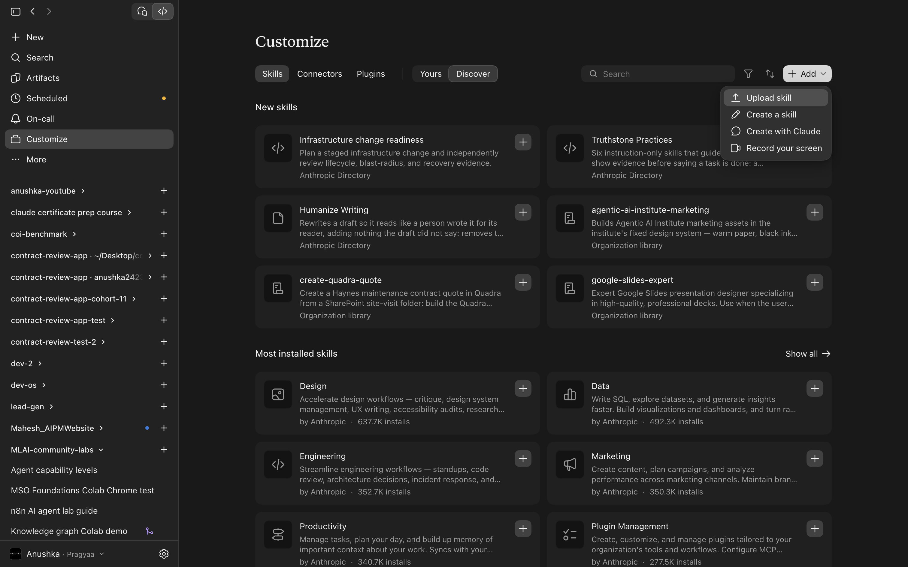
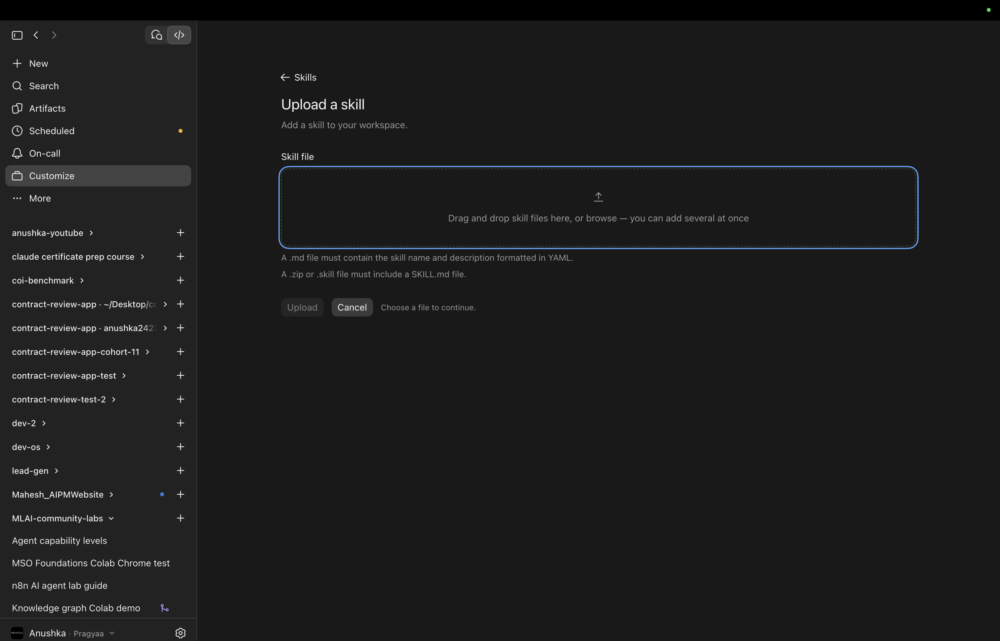
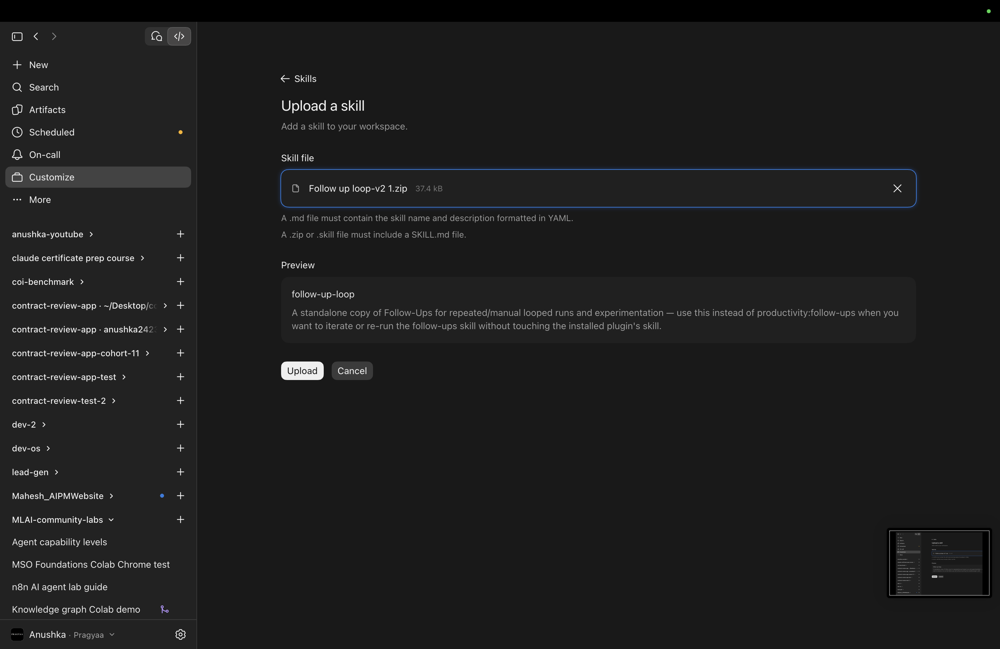
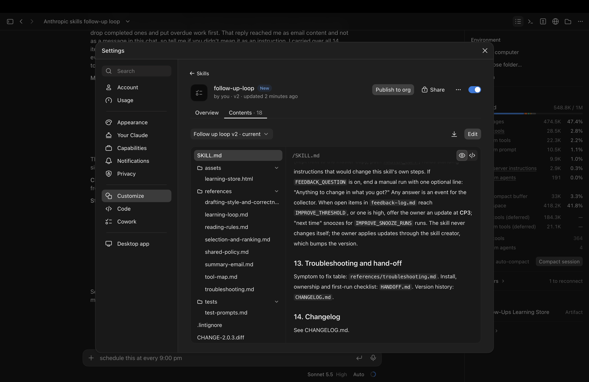
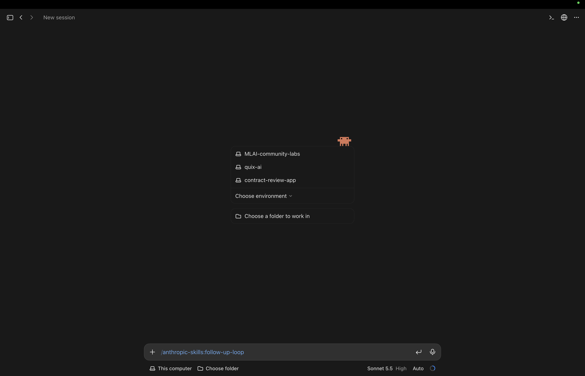
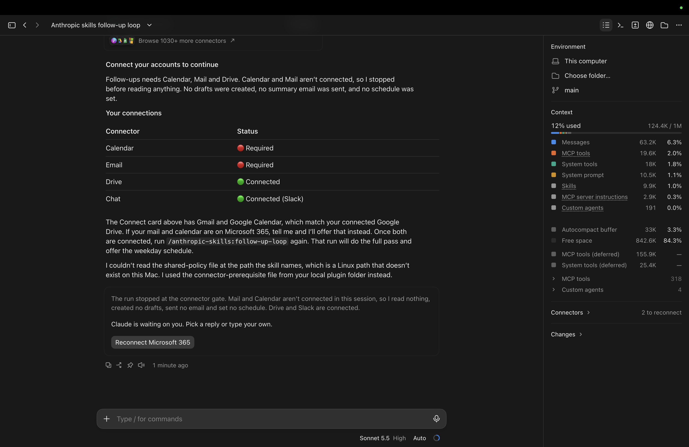
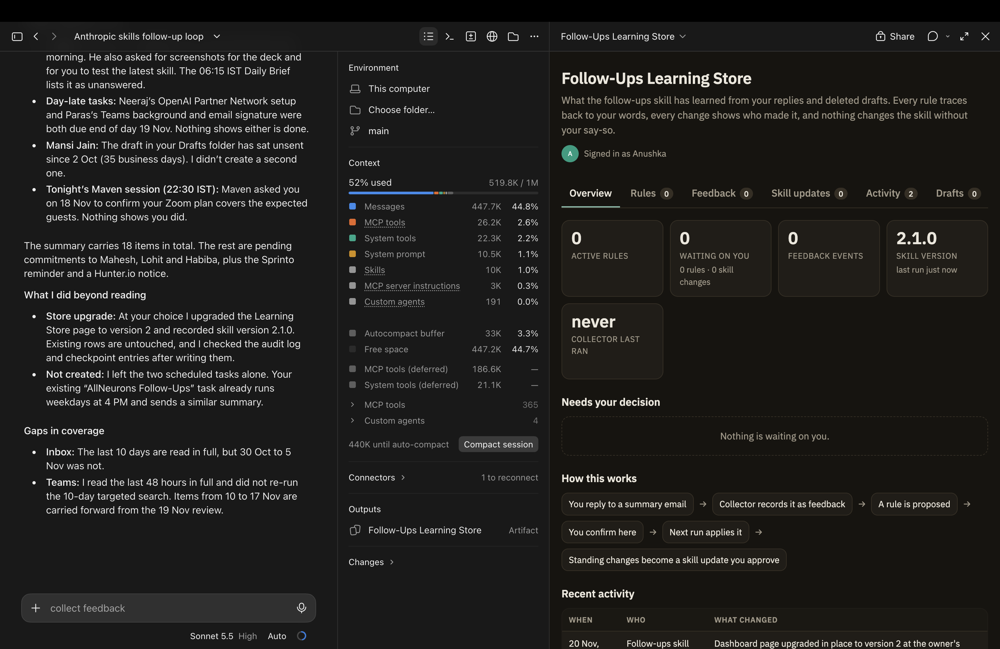
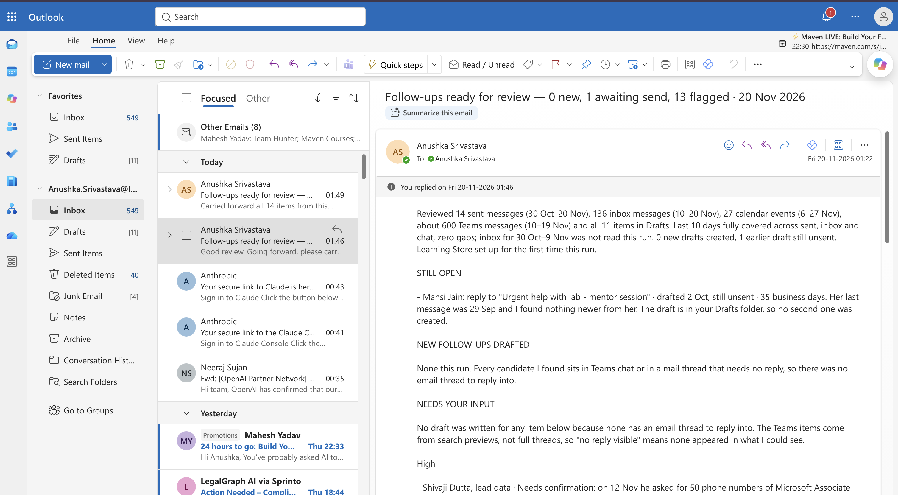
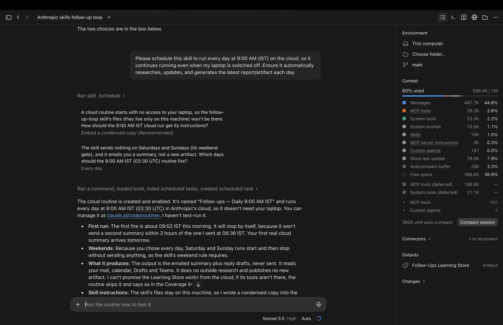

# Lab 2: Run and Schedule Your Skill

## From a Skill You Run by Hand to One That Runs Itself

In [Lab 1](../lab-01-building-an-ideal-skill/Readme.md), you learned what makes a skill strong: seven parts, six design principles, and instructions worded with numbers, reasons and fallbacks. That was all design — nothing you could run.

This lab gives you the real thing. We built the **Follow-Up skill** using those same principles, and you can download it as a single file. You'll install it, run it on your own inbox, and read what it produces. Then you'll hit the problem every useful skill hits: **you're the one who has to remember to run it.** So in the same lab, you'll ask Claude to schedule it.

Here's the flow for this lab:

- **Meet the skill.** What it reads, what it writes, and what it will never do.
- **Install and run it by hand.** Upload the file, connect your apps, and read the summary it sends you.
- **See the problem.** Why running it manually every day defeats the point.
- **Schedule it.** One prompt, and it runs every morning in the cloud — even with your laptop switched off.

---

## Table of Contents

- [Prerequisites](#prerequisites)
- [Part 1: Meet the Follow-Up Skill](#part-1-meet-the-follow-up-skill)
- [Part 2: Install the Skill](#part-2-install-the-skill)
- [Part 3: Run It by Hand](#part-3-run-it-by-hand)
- [Part 4: The Problem — You Are the Scheduler](#part-4-the-problem--you-are-the-scheduler)
- [Part 5: Ask Claude to Schedule It](#part-5-ask-claude-to-schedule-it)
- [Part 6: Check the Schedule](#part-6-check-the-schedule)

---

## Prerequisites

✅ **Lab 1 done** — you know the seven parts of a skill.

✅ **Claude app** installed and signed in.

✅ **A work mailbox** — Gmail or Outlook, with real sent and received mail. The skill learns your writing voice from it.

✅ **A calendar** — Google Calendar or Outlook Calendar.

✅ **The skill** — download [`follow-up-loop.skill`](../follow-up-loop.skill) (a ZIP-style package that contains `SKILL.md` and its supporting files). Save it somewhere easy to find.

You don't need to connect your mail and calendar yet. The skill will ask for them in Part 3.

---

## Part 1: Meet the Follow-Up Skill

Every week you promise someone something, and a few of those promises slip. The Follow-Up skill finds them for you.

| | What it does |
|---|---|
| **Reads** | Your sent mail, inbox, Drafts folder, calendar and chat |
| **Decides** | Who you owe a follow-up: a promise not kept, a question unanswered, a proposal without a reply, a date that passed, a quiet account |
| **Writes** | A reply draft for each one, inside the original thread, in your own voice |
| **Reports** | One summary email to you, with what needs you first |
| **Never** | Sends a follow-up, attaches a file, or accepts instructions hidden inside an email |

You are the last click. Nothing goes to anyone until you open the draft and press send.

### What You Need to Connect

Claude can only see what you type into the chat. A **connector** is a permissioned link between Claude and an app you already use, so it can read from it (and, in some cases, write to it). You decide which ones to hand over, and you can take any of them back.

| Role | Examples | Required? | Why the skill needs it |
|------|----------|-----------|------------------------|
| **Mail** | Gmail, Outlook | **Yes** | The source of every follow-up, your writing voice, and where the drafts land. It must be able to read mail **and** create drafts |
| **Calendar** | Google Calendar, Outlook Calendar | **Yes** | Shows meetings that already happened, and future meetings that mean no follow-up is due yet |
| **Chat** | Slack, Teams | No | Someone who replied in chat is not silent |

The skill is written in **roles**, not products. It never says "use Gmail" — it says "use whatever fills the mail role." That's why the same skill works for a Gmail user and an Outlook user without changes.

> **When a connector is missing:** the skill doesn't guess or run a half-finished version. It shows a **Connect** button for each missing one and stops. This is the run contract from Lab 1, working as designed.

---

## Part 2: Install the Skill

### 1. Open Customize

1. Open the **Claude** app.
2. In the left sidebar, click **Customize**, then open the **Skills** tab.



### 2. Add the Skill

1. Click **Add** (top right) and choose **Upload skill**.



2. Drag in the skill file, or browse for it. A single `.md` file works if it has the skill `name` and `description` in its YAML frontmatter. A `.zip` or `.skill` file works if it contains a `SKILL.md`. This skill is a folder, so you'll use the `.skill` file.



3. Select `follow-up-loop.skill`. Claude previews the skill's name and description. Click **Upload**.



### 3. Check It Installed

Claude opens the skill's page — its name, version, an on/off toggle, and a **Contents** tab listing `SKILL.md` and its supporting folders. Make sure the toggle is on.



### 4. Open It Up: Find the Seven Parts

Before you run it, open the **Contents** tab, click `SKILL.md`, and look for the seven parts from Lab 1:

- The **description** at the top — does it say when *not* to use the skill?
- A section called **Guardrails** — every rule has a reason beside it. Those are the governing rules.
- **Prerequisites** and **Step 0: validation** — that's the run contract. Find the connector gate.
- **Step 1** and **Step 2** — the evidence and the decision rules.
- The **gates** — the checks that stop a run instead of letting it guess.
- **Output** — the exact shape of what you'll get.

If you can't find a part, that's the part a weaker skill would be missing.

---

## Part 3: Run It by Hand

### 1. Start a New Session and Run the Skill

Open a **new session** — this is what makes Claude pick up the skill you just added, so don't use a chat that was already open.

Type `/` and pick **follow-up-loop** from the list. Send it as it is — no extra prompt needed.



### 2. Connect the Required Connectors

The first thing the skill does is check its connectors. If Mail or Calendar isn't connected, it stops before reading anything. It shows a card with a button for each missing connector, plus a status table — **Required** for what's missing, **Connected** for what's ready. Chat is optional and never blocks.

1. Click the **Connect** (or **Reconnect**) button for each connector it lists.
2. Sign in and approve the access.
3. Run the skill again.



> **Note:** no drafts, no email, no partial run. Stopping at the gate isn't a failure — it's the skill working as designed.

### 3. Watch It Work

With everything connected, the skill runs the agentic loop: gather context, plan, act, report back. It will:

1. Check the clock and the connectors
2. Read sent mail, inbox, calendar, chat and Drafts in one batch
3. Follow pagination until every search is exhausted
4. Study your sent mail to learn your writing voice
5. Check each candidate against the correctness gate
6. Create reply drafts and send you one summary email

On the first run it may also offer a one-time setup. If it offers to create the **Learning Store** (a dashboard), say yes — Lab 3 uses it. If it offers to create **scheduled tasks**, say *not now*: you'll schedule it yourself in Part 5.

When it finishes, Claude reports what it did: the summary email it sent, how many drafts are new or still waiting, anything it flagged, and how much of the last 10 days it covered.



> **Note:** a dashboard opens beside the chat. It's the **Follow-Ups Learning Store**. It will be mostly empty for now — that's Lab 3.

### 4. Read the Summary Email

The skill never sends a follow-up, so the last step is yours. When the run finishes, **the summary lands in your mailbox.** Open it. The subject looks like:

```
Follow-ups ready for review — 0 new, 1 awaiting send, 13 flagged · 20 Nov 2026
```

Your numbers will differ. Zero new drafts is a valid result — when nothing needs a fresh reply, the skill reports drafts still waiting and items it flagged instead of inventing follow-ups.

Check three things:

- **The numbers reconcile.** Count the items in the body. They should equal the three numbers in the subject.
- **The lead line states coverage.** It should say the last 10 days were fully covered, or name exactly what wasn't.
- **Every item has a reason with a real fact in it** — "said 14 Nov he'd confirm budget by 18 Nov", not "no reply recently."



If the run created any new drafts, open your **Drafts** folder. Each one should sit inside the original thread with the `Re:` subject, open with **your** greeting, end with **your** signature copied exactly, and contain no placeholders like `[name]`. Review it, edit if needed, and send — or leave it.

---

## Part 4: The Problem — You Are the Scheduler

You just ran the skill, read the summary and checked the drafts. It works. But look at what you actually did to get it:

1. Remembered to run it.
2. Opened a new session.
3. Typed `/` and picked the skill.
4. Waited for it to finish.

That's the weak point. The follow-ups that matter most are the ones you forget about — and a skill you have to remember to run fails at exactly the moment you forget.

| Running it by hand | What you actually want |
|---|---|
| You have to remember, every day | It runs without you |
| It only runs when your laptop is on and a session is open | It runs while your laptop is switched off |
| The summary arrives whenever you happened to run it | The summary is waiting in your inbox every morning at the same time |
| A busy week means a skipped week | A busy week still gets its summary |

The fix is to schedule it. And you don't need to learn a scheduler — you can just ask Claude.

---

## Part 5: Ask Claude to Schedule It

Open a **new session** (or stay in the one where the skill ran) and paste this prompt:

```
Please schedule this skill to run every day at 9:00 AM (IST) on the cloud, so it
continues running even when my laptop is switched off. Ensure it automatically
researches, updates, and generates the latest report/artifact each day.
```

Claude uses its `/schedule` skill and asks you two questions before it creates anything.



### Question 1: How should the cloud run get its instructions?

A cloud routine starts with no access to your laptop, and the skill's files live on your machine. So Claude offers to **embed a condensed copy** of the instructions in the routine itself. Choose **Embed a condensed copy** — it's the recommended option, and it's what makes the routine independent of your laptop.

### Question 2: Which days should it fire?

The skill has a weekend gate: on a Saturday or Sunday it stops and sends nothing. Pick **Every day** to match your prompt — weekend runs will start and stop on their own — or choose weekdays only if you'd rather not have the empty runs.

### Read What Claude Tells You

When it's done, Claude reports back plainly: the routine is named **"Follow-ups — Daily 9:00 AM IST"**, it runs at **03:30 UTC** (which is 9:00 AM IST) in Anthropic's cloud, and you can manage it at [claude.ai/code/routines](https://claude.ai/code/routines).

Read the rest carefully, because Claude also corrects the prompt:

- **"Researches" and "generates a new artifact" aren't what this skill does.** It reads your mail, calendar, Drafts and chat, and its output is the emailed summary plus reply drafts. It does no outside research and publishes no new artifact each day. Claude says so instead of promising something the skill doesn't do.
- **The Learning Store may not work from the cloud.** If the tools aren't available in a cloud run, the routine skips it and says so in the summary's coverage line.
- **Nothing is hidden.** This is the "never state coverage that was not achieved" rule from Lab 1, showing up in a real answer.

---

## Part 6: Check the Schedule

### 1. Expect the First Run to Stop Itself

Claude notes that the first run will fire a couple of minutes after you create it — and **stop by itself**. The skill has a **run lock**: it won't send a second summary within 3 hours of the last one. You already sent one in Part 3, so the first scheduled run quietly does nothing.

That's not a failure. It's the skill refusing to flood your inbox. Your first real cloud summary arrives the next morning.

### 2. Test It If You Want To

Claude offers to run the routine right now to test it. Say yes if you want to see a cloud run immediately — but if you ran the skill by hand in the last 3 hours, expect the run lock to stop it.

### 3. Manage It

Open [claude.ai/code/routines](https://claude.ai/code/routines) to see the routine, pause it, edit the time, or delete it. A schedule is just a setting — you can change it any time by asking Claude again.

### 4. Check Tomorrow Morning

At 9:00 AM IST, open your mailbox. The summary should already be there, with the same subject line shape you saw in Part 3 and the same three counts that reconcile with the body.

---

## What You Learned

- **A skill you have to remember to run fails when you forget.** The follow-ups that matter most are the ones that slip, so the skill has to run without you.

- **Scheduling is a prompt, not a project.** You asked in plain English, answered two questions, and Claude created a cloud routine that runs while your laptop is off.

- **A cloud run can't see your laptop.** That's why Claude embeds a condensed copy of the instructions — and why anything that lives only on your machine may be skipped, with a note.

- **Good skills say what they won't do.** Claude corrected the prompt's promise of research and a new artifact, because the skill reads your accounts and emails a summary. A skill's honesty is part of its design.

- **Safety rules still hold on a schedule.** The run lock, the weekend gate and "drafts only, never send" all apply to the unattended run — nobody has to be watching.

---

You can now schedule a skill and trust it to run. But look at the summary it sends. Maybe it's too long. Maybe it should lead with deadlines. Maybe it flagged something you don't care about. Right now the skill will make those same choices every morning, forever — it doesn't learn from you. That's the gap the next lab closes.

[Go to Lab 3: Teach Your Skill From Your Feedback →](../lab-03-continuous-learning-loop/Readme.md)
