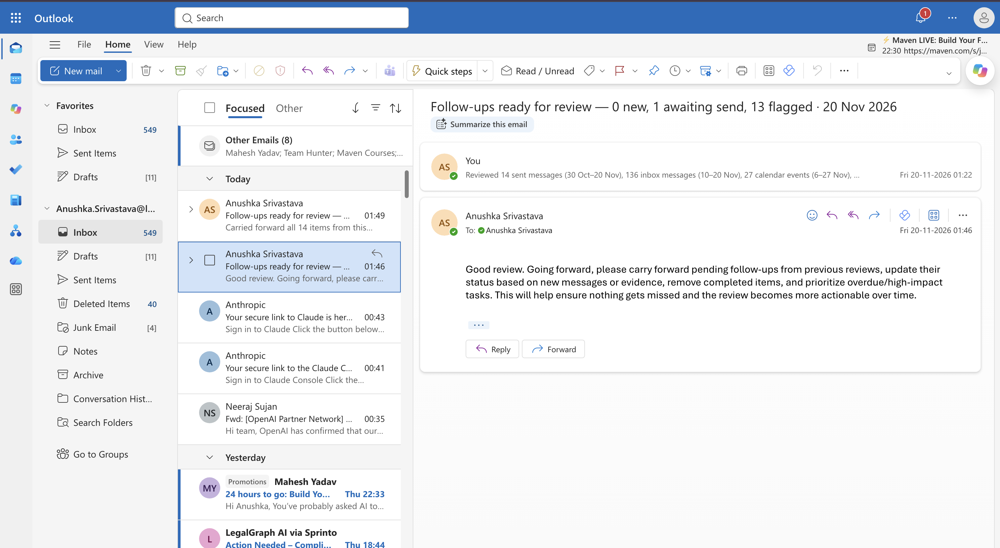
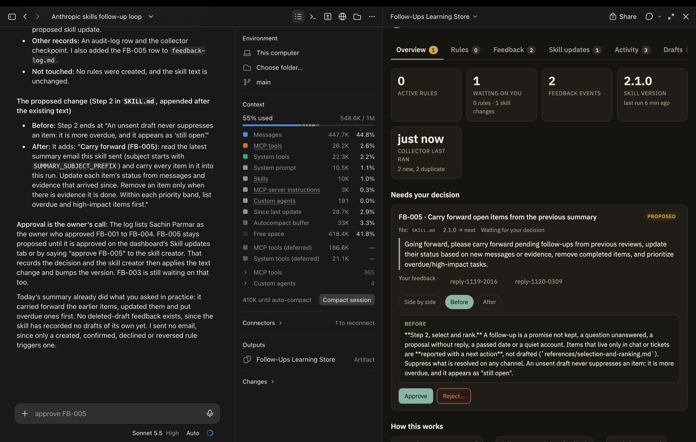
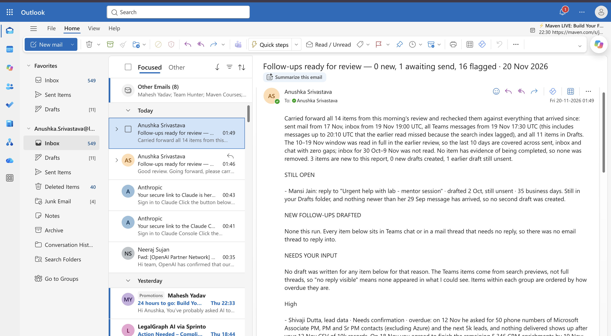

# Lab 3: Teach Your Skill From Your Feedback

## From a Skill That Repeats Itself to One That Learns

In [Lab 2](../lab-02-scheduling-your-skill/Readme.md), you scheduled the Follow-Up skill to run every morning at 9:00 AM IST. It runs without you now. But it runs the *same way* every day — if the summary is too long, or buries the deadlines, or flags things you don't care about, you'll see the same thing tomorrow, and the day after.

That's what this lab fixes. You're going to reply to the skill's summary email in plain language, let the skill collect that reply, and watch the next run do what you asked. You never edit the skill by hand.

Here's the flow for this lab:

- **Reply to the summary.** Say what to keep, what to change, what to prioritise.
- **Let the skill collect your feedback.** One command turns your reply into a proposed change.
- **Review it in the Learning Store.** See your own words, the exact before and after wording, and decide.
- **Run it again.** See your feedback show up in the next summary.

---

## Table of Contents

- [Prerequisites](#prerequisites)
- [Part 1: Why the Skill Needs a Learning Loop](#part-1-why-the-skill-needs-a-learning-loop)
- [Part 2: How the Loop Works](#part-2-how-the-loop-works)
- [Part 3: Reply to the Summary Email](#part-3-reply-to-the-summary-email)
- [Part 4: Collect Your Feedback](#part-4-collect-your-feedback)
- [Part 5: Review the Proposed Change in the Learning Store](#part-5-review-the-proposed-change-in-the-learning-store)
- [Part 6: Approve It](#part-6-approve-it)
- [Part 7: Run the Skill Again and Compare](#part-7-run-the-skill-again-and-compare)
- [Part 8: Delete a Draft You Don't Like](#part-8-delete-a-draft-you-dont-like)

---

## Prerequisites

✅ **Lab 2 done** — the Follow-Up skill is installed, and you've received at least one summary email.

✅ **Your mailbox and calendar still connected** — the skill reads your replies from your own mailbox.

✅ **The Follow-Ups Learning Store** — the dashboard that opened beside the chat during your first run. If you said *not now* to the setup in Lab 2, run the skill again and say yes when it offers to create the Learning Store.

---

## Part 1: Why the Skill Needs a Learning Loop

You could improve a skill the way you improved the first draft: read the summary, spot what's wrong, open `SKILL.md`, edit a paragraph, save, re-upload. It works, but look at what it costs:

| Editing the skill yourself | What goes wrong |
|---|---|
| You have to open and understand the instructions | Most people never do, so the feedback stays in their head |
| One careless edit can break a rule that exists for a reason | A rule learned from a real failure quietly disappears |
| Nothing records who changed what, or why | Three weeks later nobody knows why the skill behaves this way |
| You repeat it for every preference | The skill never gets better on its own |

A learning loop turns your feedback into change *without* you touching the file, and keeps a record of every change. In Lab 1 you saw the sixth design principle: **turn every failure into a rule.** This lab automates it.

---

## Part 2: How the Loop Works

The skill learns from two things: **replies you send to its summary email**, and **drafts you delete without sending.** Here's the loop:

```
You reply to a summary email
        ↓
The collector records it as feedback
        ↓
A rule is proposed          (or, for a standing instruction, a skill update)
        ↓
You confirm it in the Learning Store
        ↓
The next run applies it
```

### Two Kinds of Change

Not every piece of feedback changes the same thing:

| Kind | Example | What it changes | Where you decide |
|------|---------|-----------------|------------------|
| **Rule** | "Keep drafts under four sentences." "Put deadlines first." | How drafts are written and how the summary is laid out | The **Rules** tab — confirm or decline |
| **Skill update** | "Carry forward pending items from earlier reviews." | A step in the skill's own instructions | The **Skill updates** tab — approve or reject |

A rule never changes *whether* anything is sent. The skill drafts and never sends, whatever you teach it.

### The Collector

The part that reads your replies is the **collector**. It lives inside the skill, and it runs two ways: when you say **"collect feedback"**, or on a schedule. It looks for your replies to the skill's own summary emails, ignores replies to anything else, and records each one once.

### Three Promises the Loop Keeps

1. **Nothing changes without your say-so.** A proposed rule has no effect until you confirm it. A skill update isn't applied until you approve it.
2. **Every change shows who made it.** The dashboard keeps an activity log with who, when, and the value before and after.
3. **The skill never edits itself.** Instruction changes go through the owner, versioned, with a changelog.

---

## Part 3: Reply to the Summary Email

Open the latest summary email in your mailbox and **reply to it** in plain language. Say what to keep, what to change, what to prioritise. You don't need to write in any special format.

Here's an example reply:

```
Good review. Going forward, please carry forward pending follow-ups from
previous reviews, update their status based on new messages or evidence,
remove completed items, and prioritize overdue/high-impact tasks. This will
help ensure nothing gets missed and the review becomes more actionable over time.
```

Use your own words — what bothers *you* about the summary is the point. Send the reply.



> **Note:** the reply goes to your own inbox, because the summary was sent from you to you. That's normal. The collector finds it by the subject line.

---

## Part 4: Collect Your Feedback

Open a **new session**, type `/`, pick **follow-up-loop**, and tell it:

```
collect feedback
```

This runs the skill in **collect mode** — it doesn't read your whole inbox again. It only looks for new replies to its summary emails, and for drafts that disappeared without being sent.

When it finishes, Claude reports what it found in chat. Look for:

- **How many new feedback events** it recorded, and how many it skipped as duplicates. A reply you send to yourself exists twice in your mailbox (Sent and Inbox), and the collector counts it once.
- **What it created from your reply** — a proposed rule, a proposed skill update, or just a recorded event if your reply was a one-off remark.
- **What it didn't touch.** It says plainly that no rule is active and the skill text is unchanged until you decide.

---

## Part 5: Review the Proposed Change in the Learning Store

Open the **Follow-Ups Learning Store** dashboard. It's no longer empty.



Walk through what's on the page:

| Part of the page | What it tells you |
|---|---|
| **Active rules** | How many learned rules are currently shaping the skill. Still 0 — nothing is active until you confirm it |
| **Waiting on you** | Rules and skill changes that need your decision |
| **Feedback events** | How many replies and deleted drafts it has picked up |
| **Skill version** | The version of the instructions that last ran |
| **Collector last ran** | When it last read your replies, and how many were new or duplicates |
| **Needs your decision** | The proposed change itself, with your own words as evidence |

The tabs along the top are your control room:

- **Overview** — what's waiting on you, and recent activity.
- **Rules** — confirm, decline (with a reason), reverse or reopen a rule.
- **Feedback** — your replies and deleted drafts, and which rule each one led to.
- **Skill updates** — proposed changes to the skill's own text.
- **Activity** — every change with who, when, and before and after.
- **Drafts** — the drafts the skill created, and what became of them.

### Read the Proposed Change

Under **Needs your decision** you'll see a card like **FB-005 · Carry forward open items from the previous summary**, marked **Proposed**. It shows:

- **Your feedback** — the exact words you wrote, linked to the reply they came from.
- **Before / After / Side by side** — the exact paragraph in the skill's instructions today, and the exact wording that would replace it.

Click through **Before**, **After** and **Side by side**. Read the new wording and ask the question that matters: *Does this say what I meant, and nothing more?*

---

## Part 6: Approve It

If the wording is right, approve it. If it isn't, click **Reject** and leave a note — the feedback stays on record as evidence either way.

### For a Skill Update

1. In the Learning Store, click **Approve**. This records your decision. It does **not** change the skill yet.
2. Go back to Claude and type the approval, using your own FB number:

```
approve FB-005
```

Claude then applies the approved wording to the skill, bumps the version, writes a changelog entry, and marks the change as applied. The dashboard's **Skill updates** tab shows the status moving from *proposed* to *approved* to *applied*.

### For a Rule

If your feedback became a **rule** instead, open the **Rules** tab and **confirm** it. No chat command needed — a confirmed rule applies from the next run.

> **Why two steps?** Approving in the dashboard is *your* decision. Applying is a separate, versioned edit. That's how you can always see who decided what, and roll a change back.

---

## Part 7: Run the Skill Again and Compare

Open a new session, type `/`, pick **follow-up-loop**, and send it — the same way you ran it in Lab 2. Then open the new summary email.



Compare it with your first summary. Look for your feedback showing up:

- **The lead line has changed.** In the example, it now says it carried all 14 items forward from the earlier review, rechecked them against everything that arrived since, and removed none because none had evidence of being done.
- **It tells you what's new.** It says how many items are new to this report — here, 3.
- **Overdue and high-impact items come first**, as you asked.
- **A skill update notice** appears: *"Skill instructions updated to `<version>`: `<what changed>` (`FB-005`)."* That one line is how you know the instructions changed.

Then open the **Activity** tab in the Learning Store. Every step is there — your feedback, the proposal, your approval, the applied change — with who did it, when, and the value before and after.

### Don't Forget the Schedule

When you scheduled the skill in Lab 2, Claude embedded a *copy* of the instructions in the cloud routine. A copy made before your approval won't have the new wording. After a skill update, ask Claude to refresh it:

```
Update my "Follow-ups — Daily 9:00 AM IST" routine so it uses the latest
version of the follow-up-loop skill.
```

Also remember what Lab 2 told you: a cloud run may not be able to reach the Learning Store. If a learned rule didn't apply to a scheduled run, the summary's coverage line says so.

---

## Part 8: Delete a Draft You Don't Like

Replies aren't the only feedback. When you **delete a draft without sending it**, the collector notices that too.

- One deleted draft is recorded as an event and nothing more — it might have been a one-off.
- **Three or more deletions of the same kind of draft** (say, polite check-ins to quiet accounts) become an *inferred* rule, proposed for you to confirm.

So you can teach the skill without writing a word: just delete what you wouldn't send. The next time you say **"collect feedback"** — or when the scheduled collector runs — the pattern shows up in the **Feedback** tab and a rule shows up in **Rules**, waiting for your decision.

---

## What You Learned

- **A reply is feedback.** Telling the skill what to change, in plain language, is all it takes. You never open `SKILL.md`.

- **The loop has a human in it on purpose.** The collector records, a rule or update is proposed, and you decide. Nothing changes the skill without your approval.

- **Rules and skill updates are different.** A rule shapes drafts and the summary; a skill update changes a step in the instructions. Each has its own tab and its own approval.

- **Every change is traceable.** The Activity tab shows who changed what, when, and the wording before and after — the opposite of a skill that quietly drifts.

- **A scheduled copy is a copy.** When you update the skill, refresh the routine, and check the coverage line to see what a cloud run could and couldn't reach.

---

The loop now teaches the skill *how you like things done* — your tone, your priorities, your layout. But there's something it still can't learn from a reply: **the facts about your business.** When a follow-up is about a loan, a contract or a renewal date, the skill is drafting without knowing what the paper actually says. In the next lab you'll give it that knowledge — a company brain — and connect it to the same learning loop so it keeps improving.

[Go to Lab 4: Give Your Skill a Company Brain →](../lab-04-company-brain/Readme.md)
