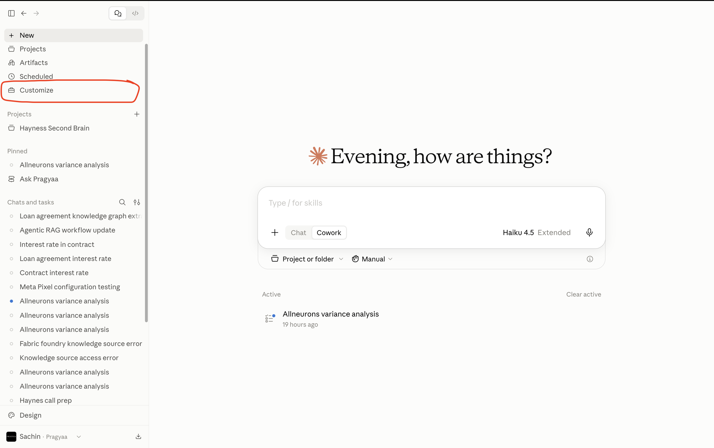
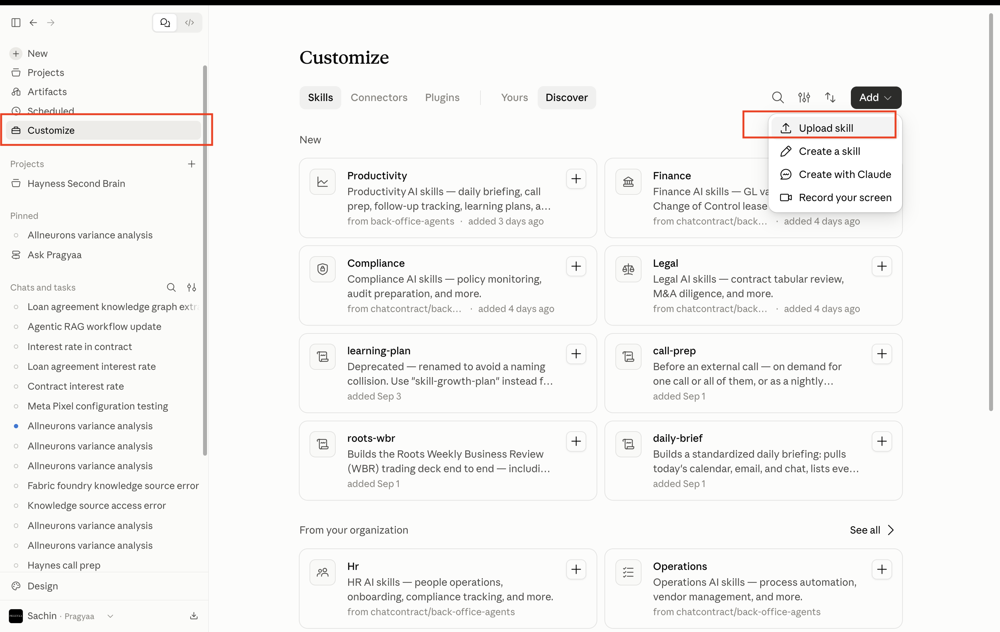
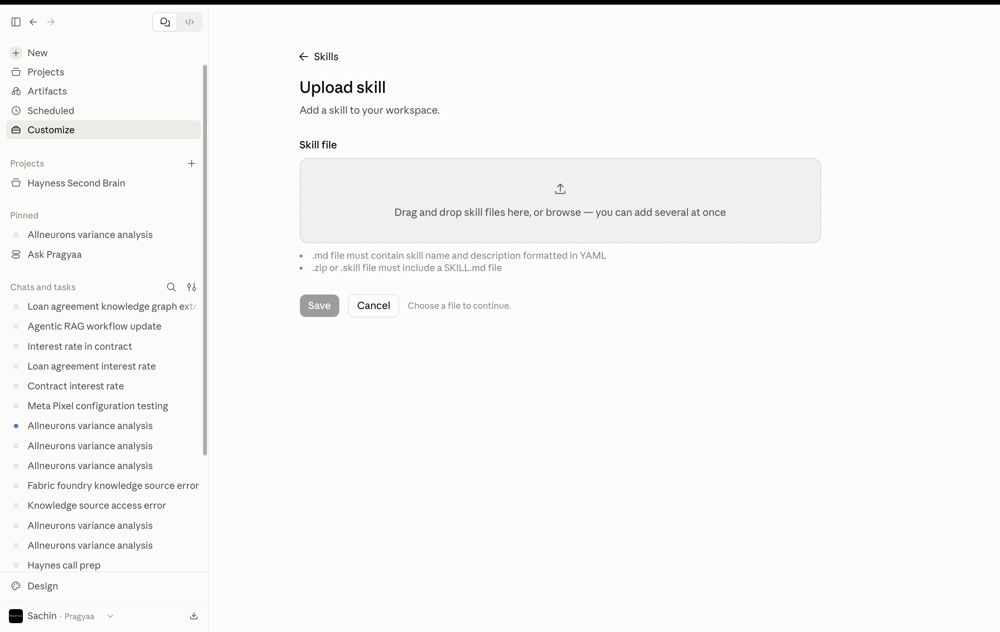
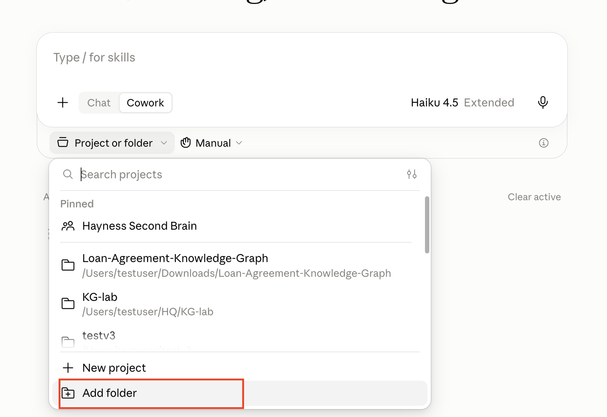
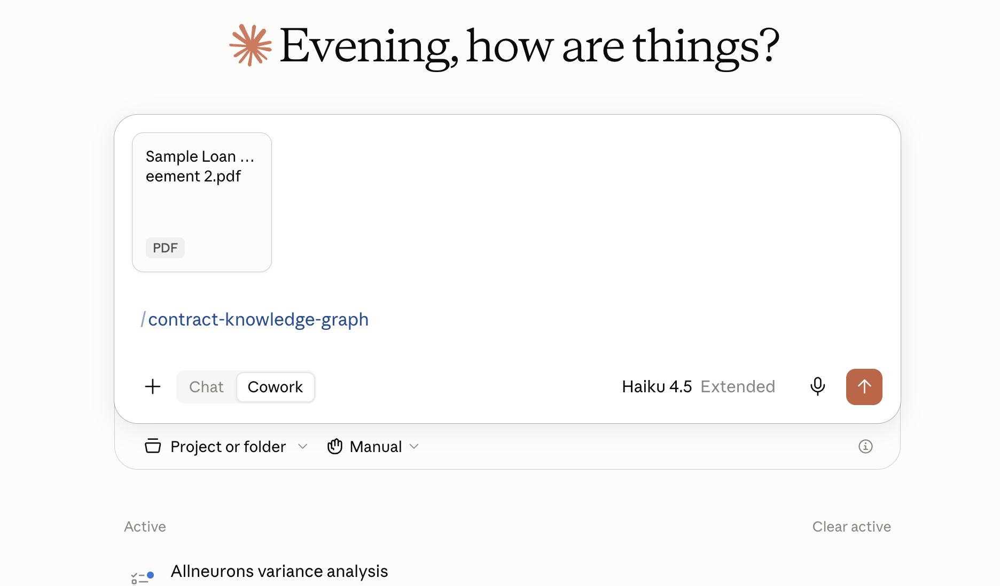
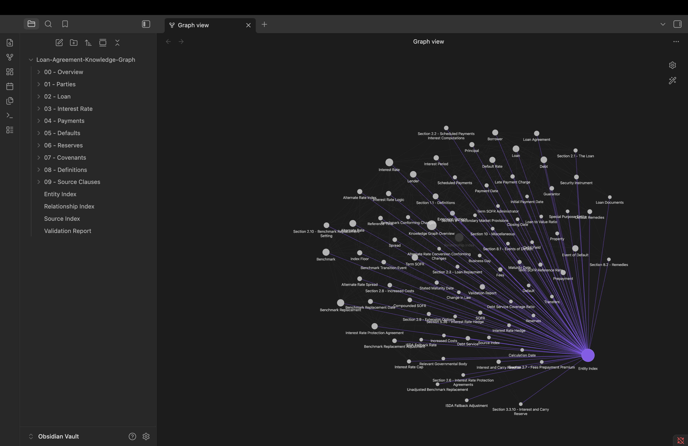
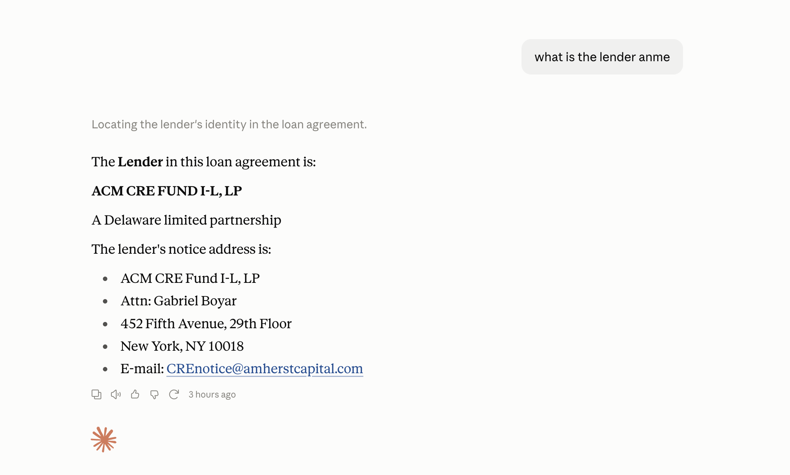

# Lab 4: Give Your Skill a Company Brain

## From a Skill That Learns How You Write to One That Knows What Your Contracts Say

> **Who this is for:** No coding background needed. This guide walks you through every step, then explains what is happening under the hood.

In [Lab 3](../lab-03-continuous-learning-loop/Readme.md), you taught the Follow-Up skill *how you like things done* — your tone, your priorities, your layout — just by replying to its summary email. That's a real improvement. But there's something a reply can't teach it: **the facts in your documents.**

When a follow-up is about a loan, a lease or a renewal, the skill is drafting without knowing what the paper actually says. It can write a polite "checking in on the payment" — but it can't tell you the payment was due on the Maturity Date, at the rate defined in Schedule A, with a ten-day notice period. You'd have to look that up yourself.

This lab fixes that. You'll turn a contract into a **Context Brain** — a knowledge graph of linked files that Claude can read quickly and cheaply — and connect it to the same learning loop from Lab 3, so the skill keeps improving as your documents and your feedback change.

Here's the flow for this lab:

- **See the cost of the raw approach.** Why re-uploading a contract for every question wastes tokens and still gives partial answers.
- **Build a Context Brain.** Turn a contract into a graph of linked Markdown files with a skill.
- **Explore it and question it.** Visualize it in Obsidian, then ask questions that need cross-references.
- **Connect it to the Follow-Up skill.** Let the skill draft with real clauses, and teach it to do so through the Lab 3 loop.
- **Keep it learning.** Update the brain when documents change, and the skill when your feedback changes.

---

## Table of Contents

- [Prerequisites](#prerequisites)
- [Part 1: The Real Problem — Token Consumption](#part-1-the-real-problem--token-consumption)
- [Part 2: The Solution — A Context Brain](#part-2-the-solution--a-context-brain)
- [Part 3: Set Up the Skill in Claude](#part-3-set-up-the-skill-in-claude)
- [Part 4: Build Your Context Brain](#part-4-build-your-context-brain)
- [Part 5: Visualize the Brain in Obsidian](#part-5-visualize-the-brain-in-obsidian)
- [Part 6: Understand Entities and Relationships](#part-6-understand-entities-and-relationships)
- [Part 7: Ask Questions Using the Context Brain](#part-7-ask-questions-using-the-context-brain)
- [Part 8: What Happened Behind the Scenes](#part-8-what-happened-behind-the-scenes)
- [Part 9: Connect the Brain to the Follow-Up Skill](#part-9-connect-the-brain-to-the-follow-up-skill)
- [Part 10: Keep the Brain and the Skill Learning](#part-10-keep-the-brain-and-the-skill-learning)

---

## Prerequisites

✅ **Labs 1–3 done** — the Follow-Up skill is installed, scheduled, and you've sent it feedback at least once.

✅ **Claude app** installed and signed in.

✅ **The Context Brain skill** — the skill that extracts the knowledge graph from your contract.
[Download the Skill →](https://pragyaallc-my.sharepoint.com/:u:/g/personal/sachin_parmar_legalgraph_ai/IQAFc5y1wj7RQa1YLPVhsMslAa9EqcDaW3LFtUN--5k3F78?e=5eYchc)

✅ **A sample contract** — the loan agreement you'll use in this lab.
[Download the Contract →](https://pragyaallc-my.sharepoint.com/:b:/g/personal/sachin_parmar_legalgraph_ai/IQAoCWuA_rpWRq9eVWL6MJCeAeF0-mDO7j1ueQe6RxKL4mU?e=YvV2wc)

✅ **Obsidian** — a free note-taking app that draws the graph. Install it first with the [Foundation Lab](./foundation/Readme.md) if you don't have it.

Save the skill file and the contract somewhere easy to find — you'll need them in Parts 3 and 4.

---

## Part 1: The Real Problem — Token Consumption

You've seen what happens when you upload a contract and ask Claude questions about it. It works. But there's a cost most people never think about: **every word you send to Claude costs tokens.**

### What are tokens?

Tokens are the units AI models use to read and write. Roughly:

- **1 token ≈ 4 characters of English text**
- A typical 30-page loan agreement ≈ **15,000 – 25,000 tokens**

Every time you start a new conversation and attach that contract, those tokens are consumed again — just to give Claude the context it needs to answer.

### The naive approach (what most people do)

```
Question 1:  Upload contract (20,000 tokens) + question (50 tokens)  = 20,050 tokens
Question 2:  Upload contract (20,000 tokens) + question (60 tokens)  = 20,060 tokens
Question 3:  Upload contract (20,000 tokens) + question (45 tokens)  = 20,045 tokens
                                                                       ─────────────
                                                              Total ≈  60,155 tokens
```

You're paying to re-read the entire document every single time. And despite that cost, the answers are often incomplete — because retrieval finds *chunks*, not the connected meaning spread across sections.

For the Follow-Up skill the cost is worse. It runs every morning. If it re-read every contract behind every follow-up, every day, you'd pay that bill daily.

---

## Part 2: The Solution — A Context Brain

A **Context Brain** is a knowledge graph extracted from your document. Instead of storing your contract as pages of text, it stores it as a **network of connected facts.**

- A **raw document** is like a book. To find anything, you re-read the whole thing.
- A **Context Brain** is like a well-organized index combined with a map of how every topic connects. You jump straight to what matters and follow the connections.

Building the brain is a one-time cost. After that, every question uses only the lightweight graph — not the full document.

| | **Before — Raw Upload** | **After — Context Brain** |
|---|---|---|
| **What Claude reads per question** | The full contract (~20,000 tokens) | Compact graph files (~3,000–5,000 tokens) |
| **Tokens per question** | ~20,050 | ~3,050 |
| **Token reduction** | — | **roughly 85% fewer** |
| **Answer quality** | Partial — stops at the first matching chunk | Complete — follows cross-references to the full answer |
| **Re-upload needed?** | Every new conversation | No — the brain is built once and reused |
| **Can you inspect it?** | No — the document is a black box | Yes — every node and edge is visible in Obsidian |

> These numbers are typical for a 30-page contract. Your savings depend on the document — the more cross-referenced it is, the bigger the gap.

### How a knowledge graph compresses your document

A knowledge graph reads every clause and asks two questions:

- *What are the important things mentioned here?* — these become **entities** (nodes).
- *How are those things connected?* — these become **relationships** (edges).

Take this clause:

> *"The Borrower shall repay the Principal Amount to the Lender on the Maturity Date at the Interest Rate specified in Schedule A."*

**Raw storage** saves the entire sentence as a text chunk. Every time you ask about it, the whole chunk is sent.

**Context Brain storage** saves only the structure:

```
[Borrower] ──REPAYS──► [Principal Amount]
[Principal Amount] ──PAID_TO──► [Lender]
[Repayment] ──OCCURS_ON──► [Maturity Date]
[Repayment] ──USES_RATE──► [Interest Rate]
[Interest Rate] ──DEFINED_IN──► [Schedule A]
```

Five short lines replace a full sentence — and they carry *more* meaning, because the connections are explicit. Ask *"What is the interest rate?"* and the brain follows the `DEFINED_IN` edge directly to Schedule A. No re-reading. No searching.

| Question | Raw upload | Context Brain |
|---|---|---|
| *"What is the interest rate?"* | The clause that mentions the rate | The clause **plus** the schedule that defines the actual number |
| *"What triggers a default?"* | The most keyword-similar paragraph | The full chain: trigger → definition → consequences → notice requirements |
| *"Can the loan be repaid early?"* | The prepayment clause | The clause **plus** the penalty formula and any referenced exhibit |

---

## Part 3: Set Up the Skill in Claude

The Context Brain skill is built the same way as the Follow-Up skill — a Markdown file with a `name`, a `description` and step-by-step instructions. Its job:

> *"Read this contract. Extract every party, defined term, obligation and condition, and every relationship between them. Cite every fact to an exact page and section. Save the result as a folder of linked Markdown files."*

You install it exactly as you installed the Follow-Up skill in Lab 2.

1. Open the **Claude** app, then click **Customize**.



2. Open the **Skills** tab, click **Add**, and choose **Upload skill**.



3. Drag in the skill file you downloaded, or browse for it, then click **Save**.



> ✅ You should see the skill listed with its name — `contract-knowledge-graph`. It's available in every new session, alongside your Follow-Up skill.

---

## Part 4: Build Your Context Brain

### 1. Start a session with a folder

1. Click **New chat** in the Claude sidebar.
2. Add a **project folder** — a folder on your computer where Claude can write the files it creates. Pick an empty folder and call it something like `loan-agreement-brain`.



### 2. Run the skill on the contract

1. Click the **paperclip icon** (or **Attach files**) and attach the loan agreement.
2. In the message box, type `/` and select **contract-knowledge-graph**.
3. Press **Enter**.



> ✅ You should see the contract listed above the message box. Claude can now read it.

> **This is the one time you pay the full token cost.** Claude reads the whole contract here and converts it into a compact Context Brain. Every question after this uses the brain, not the raw contract.

Claude now reads the contract and extracts the parties, defined terms, obligations, conditions and the connections between them. When it finishes, open the folder you linked. You'll find a set of **Markdown files** — one per entity, with `[[links]]` between files standing for the relationships.

> Each file is one node in the graph. The `[[links]]` inside it are the edges. Because the skill cites every fact to an exact page and section, you can always check a fact against the original contract.

---

## Part 5: Visualize the Brain in Obsidian

You don't *need* Obsidian to use the brain — Claude reads the files directly. But seeing the graph helps you trust it.

1. Open **Obsidian**.
2. Click **Open folder as vault**.
3. Select the folder Claude wrote the Markdown files into. Obsidian loads all the files.
4. Click the **Graph view** icon in the left sidebar (it looks like a network of dots).



> ✅ You should see a visual graph. Each node is an entity from the contract, and each line is a relationship. Hover over a node to see its name; click it to open the file and read the details.

This is the Context Brain you built. Every node is a compressed fact. Every edge is a connection the document spread across paragraphs or pages.

---

## Part 6: Understand Entities and Relationships

Before you ask questions, it helps to know what you're looking at.

### Entities — the "things" in your contract

An entity is any named concept that matters. In a loan agreement:

| Entity | What it is |
|---|---|
| **Borrower** | The party receiving the loan |
| **Lender** | The party providing the loan |
| **Principal Amount** | The total sum being lent |
| **Interest Rate** | The cost of borrowing, as a percentage |
| **Maturity Date** | The date by which the loan must be repaid |
| **Event of Default** | A condition that triggers the lender's right to demand repayment |
| **Schedule A** | An exhibit containing defined rates or terms |
| **Prepayment Penalty** | A fee charged if the borrower repays early |

### Relationships — the connections between them

A relationship is a labelled connection between two entities.

| From | Relationship | To | Plain English |
|---|---|---|---|
| Borrower | `OWES` | Principal Amount | The borrower owes the principal |
| Interest Rate | `DEFINED_IN` | Schedule A | The rate is specified in Schedule A |
| Event of Default | `TRIGGERS` | Acceleration | A default lets the lender demand full repayment |
| Prepayment | `SUBJECT_TO` | Prepayment Penalty | Early repayment may incur a fee |
| Maturity Date | `GOVERNS` | Final Payment | The maturity date is when the last payment is due |

Without the graph, a search for *"What is the interest rate?"* finds the **Interest Rate** clause and stops. The Context Brain follows the `DEFINED_IN` edge all the way to **Schedule A** and reads what it says. That one extra step is what makes the answer complete — and it costs far fewer tokens.

---

## Part 7: Ask Questions Using the Context Brain

### 1. Start a new session with the brain attached

1. In Claude, start a **new chat** in the same project, so the brain folder is attached.
2. Don't attach the contract. The Markdown files Claude generated are already in the folder — that's what it will read.

### 2. Ask the questions

Try these:

> *"What is the interest rate on this loan?"*

> *"Can the borrower repay the loan early, and is there a penalty?"*

> *"What happens if the borrower misses a payment?"*

> *"What triggers an event of default?"*



> ✅ This time you should see complete answers — ones that name actual values and conditions, not just phrases like *"as set forth in the applicable schedule."*

Watch how the answers cite more than one section. That's the graph at work: Claude found the entry point, then followed the edges to collect the full picture before writing.

> **Test it:** ask the same question once with the raw contract attached, and once with only the brain. Compare how much each session used. The brain session should use far fewer tokens.

---

## Part 8: What Happened Behind the Scenes

### Stage 1 — Building the brain (one-time token cost)

```
You uploaded the raw contract  (~20,000 tokens — paid once)
        ↓
The skill told Claude to read every clause
        ↓
Claude identified entities: Borrower, Lender, Interest Rate, Schedule A, ...
        ↓
Claude identified relationships: Interest Rate → DEFINED_IN → Schedule A
        ↓
Claude wrote one Markdown file per entity, with [[links]] between related files
        ↓
Your folder now holds the Context Brain  (~3,000–5,000 tokens)
```

### Stage 2 — Answering questions (low token cost, every time)

```
You asked: "What is the interest rate?"  (~50 tokens)
        ↓
Claude searched the brain for the most relevant entity  (~3,000 tokens)
        ↓
Claude followed the DEFINED_IN edge to Schedule A, and read it
        ↓
Claude combined both into one complete answer
        ↓
Total cost per question: ~3,050 tokens  (vs. ~20,050 with the raw contract)
```

| | **Raw Upload** | **Context Brain** |
|---|---|---|
| **How it stores the document** | As chunks or a raw file | As a graph of connected Markdown files |
| **Tokens per question** | ~20,050 (full document every time) | ~3,050 (compact brain only) |
| **How it retrieves** | Finds the most similar chunk | Finds the most relevant entity, then follows its edges |
| **Cross-references** | Returns the clause that contains the reference | Follows the reference to its target |
| **What you can inspect** | The chunk that was retrieved | The full brain in Obsidian — every node and edge |

The raw approach is simple and works for short documents. The Context Brain pays a one-time extraction cost, then answers every future question faster, cheaper and more completely.

---

## Part 9: Connect the Brain to the Follow-Up Skill

Now bring the two halves together. The Follow-Up skill finds who you owe a reply. The Context Brain knows what your contracts say. Together, a follow-up about the loan can quote the real clause instead of a vague "checking in."

### 1. Run the Follow-Up skill with the brain in reach

Start a **new chat in the same project** — the one with the brain folder attached — and run the skill as before: type `/` and pick **follow-up-loop**.

Claude can read the brain folder in that session. But the Follow-Up skill doesn't *know* to look there yet, and nothing in its instructions says how to use what it finds. You could edit the skill by hand. You don't need to — you've got a learning loop.

### 2. Teach it through the Lab 3 loop

Open the summary email and **reply** with what you want, in plain language:

```
When a follow-up is about a contract, look it up in the Context Brain folder
first. Use the real dates, amounts and notice periods from the brain in the
draft, and say which clause they came from. If the brain has nothing on it,
say so instead of guessing.
```

Then follow the same steps as Lab 3:

1. **Collect.** Open a new session, pick **follow-up-loop**, and say `collect feedback`.
2. **Review.** Open the **Follow-Ups Learning Store**. Your reply arrives as a proposed change — most likely a **skill update**, because it changes a step in how the skill drafts. Read the exact before and after wording.
3. **Approve.** Click **Approve**, then type `approve FB-<number>` in Claude, using the number the dashboard shows.
4. **Run again.** Open a new chat in the brain project and run `/follow-up-loop`.

### 3. Check the result

Open the new summary and the drafts. For a follow-up that touches the contract, look for:

- **A real fact in the reason or the draft** — a date, an amount or a notice period, with the clause it came from.
- **A source you can check.** The brain cites every fact to a page and section, so open the contract and confirm.
- **An honest gap.** When the brain has nothing relevant, the draft says so instead of inventing a term.

Then ask the self-check question from Lab 2: **would this pass as mine, and is every fact in it correct?** The skill still never sends anything — you review every draft, and checking the cited clause takes seconds.

> **Note on scheduling:** a scheduled cloud run can't see files on your laptop — you saw this in Lab 2. Brain-powered follow-ups work in the manual runs you start here. For the daily 9:00 AM run to use the brain, the brain has to live somewhere the routine can read. Ask Claude where a cloud routine can read it from, and tell it to update the routine.

---

## Part 10: Keep the Brain and the Skill Learning

You now have two things that learn, and they learn different things.

| What | Where it lives | What changes it |
|------|----------------|-----------------|
| **How you like things done** — tone, length, priorities, layout | The **Learning Store** (Lab 3) | Your replies and the drafts you delete |
| **What your documents say** — parties, dates, amounts, clauses | The **Context Brain** (this lab) | New or changed documents |

Both improve through the same habit: **review, reply, run again.**

```
Your documents
     ↓  built once, rebuilt when they change
The Context Brain
     ↓  read by
The Follow-Up skill drafts with real clauses
     ↓
You review the drafts and reply
     ↓
The collector records it → a rule or skill update → you approve
     ↓
The next run is better
     ↓
A wrong or missing fact? Fix the document, rebuild the brain
```

### When to Update the Brain

| What happened | What to do |
|---|---|
| **A new contract arrived** | Run `/contract-knowledge-graph` on it and save it into the project folder |
| **A contract was amended** | Run the skill again on the amended document, so the brain reflects the current terms |
| **A draft quoted a fact that was out of date or missing** | Reply to the summary with what was wrong, so the skill records it, and rebuild the brain from the current document |
| **The brain and the contract disagree** | The contract wins. The brain is a map of it, not a replacement for it |

### When to Update the Skill

| What happened | What to do |
|---|---|
| **You want a different tone, length or layout** | Reply to the summary email — it becomes a rule |
| **You want the skill to use the brain differently** | Reply with the new instruction — it becomes a skill update you approve |
| **You keep deleting the same kind of draft** | Just delete it — three of the same kind become a proposed rule |

> **The principle behind both:** nothing here changes silently. The skill changes through proposals you approve and a changelog that records them. The brain changes when you rebuild it from a document you chose. You stay in control of both.

---

## What You Learned

- **Raw uploads are expensive and incomplete.** Re-reading a whole contract for every question wastes tokens, and chunk retrieval misses what's spread across sections.

- **A Context Brain trades one cost for many savings.** Pay once to build the graph, then every question uses a compact, connected representation — roughly 85% fewer tokens, with more complete answers.

- **You can inspect the brain.** Every node and edge is visible in Obsidian, and every fact cites a page and section, so nothing has to be taken on trust.

- **Skills and knowledge are separate things that learn separately.** The Learning Store learns how you like things done. The brain holds what your documents say. Each has its own way of staying current.

- **The learning loop is general.** You used the same reply, collect, approve, run-again loop from Lab 3 to teach the skill to *use* the brain. Any new behaviour you want can go the same way.

---

## What You Built in This Workshop

| Lab | What you did | What it gave you |
|-----|--------------|------------------|
| **1 — Design the best skill** | Learned the seven parts, the six principles and how to word instructions | A way to judge any skill |
| **2 — Run and schedule your skill** | Installed it, ran it, then scheduled it in the cloud | A skill that runs every morning without you |
| **3 — Teach it from feedback** | Replied, collected, approved, ran again | A skill that improves from your reviews |
| **4 — Give it a company brain** | Turned a contract into a graph and connected it to the loop | A skill that drafts with the facts, and keeps learning |

You started with a prompt you retyped every week. You finish with a skill that runs itself, learns from you, and knows your documents — and you can read, check and reverse every change it makes.
